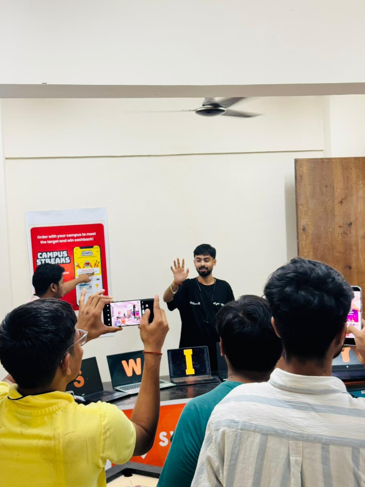
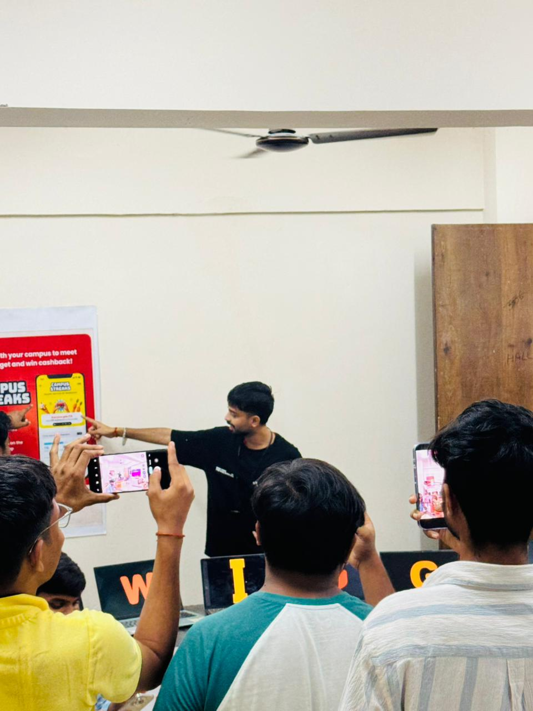
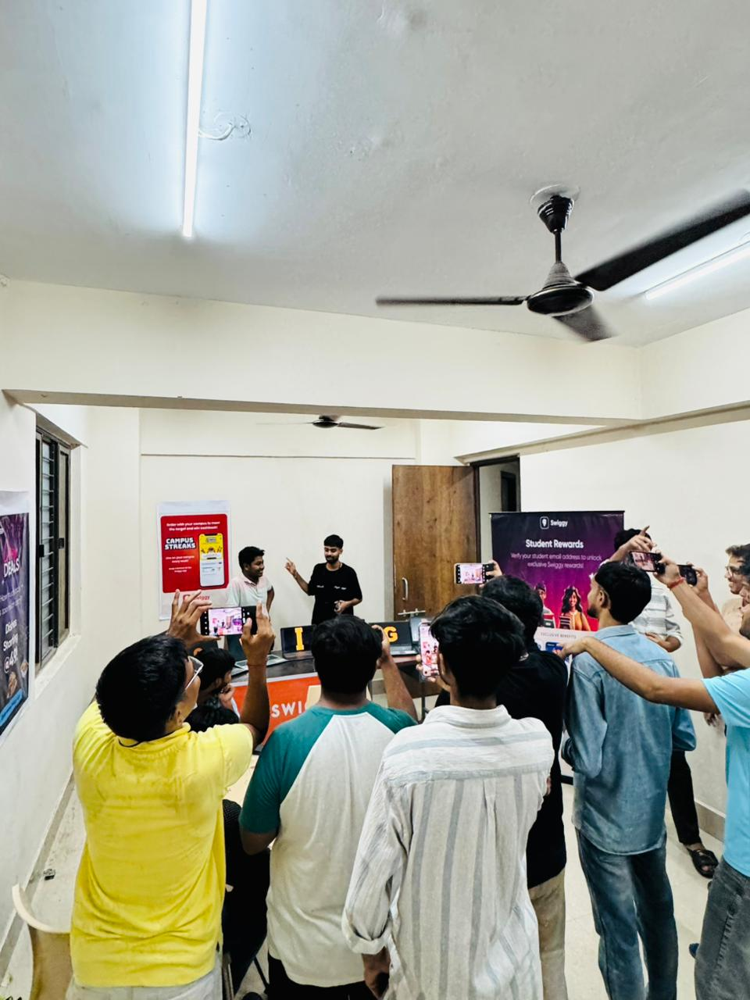
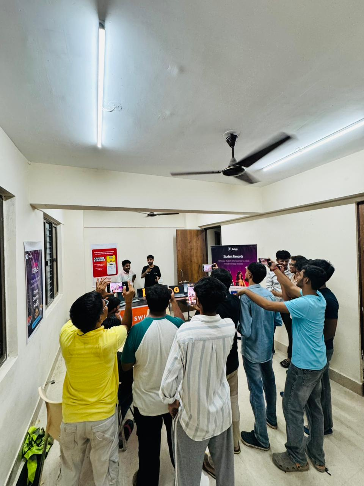

# 🍔 Swiggy Campus Marketing & User Acquisition Campaign

  
  
  

  <b>Turning campus engagement into measurable user acquisition.</b>

---

## 📌 Overview

A campus-based marketing activation for **Swiggy**, executed through **Parivestra Ventures** at NIT Patna.

The campaign focused on creating brand awareness, engaging students through interactive activities, and driving registrations by promoting Swiggy One through an incentive-based approach.

This experience provided practical exposure to on-ground marketing, user engagement, customer acquisition, and campaign execution.

---

## 🎯 Campaign Objectives

- Increase Swiggy's brand awareness among college students.
- Create an engaging offline experience through interactive games.
- Encourage students to explore Swiggy's offerings.
- Drive user registrations through incentive-based promotion.

---

## ⚡ Campaign Execution

| Activity | Description |
|---|---|
| 📢 Brand Promotion | Displayed promotional banners and campaign branding across the event space. |
| 🎮 Student Engagement | Organised interactive games and activities to attract and engage students. |
| 🤝 Direct Interaction | Communicated the campaign offer directly to students. |
| 🎁 Incentive Marketing | Offered a free Swiggy One subscription as an incentive for registration. |
| 📈 User Acquisition | Converted student interest into registrations through on-ground promotion. |

---

## 📊 Campaign Impact

  <h1 align="center">300+</h1>
  
<b>Student Registrations Generated</b>

The campaign leveraged direct student engagement, interactive activities, and an incentive-based registration approach to generate participation and drive sign-ups.

---

## 📸 Campaign Gallery

> Photographs from the on-campus activation, student engagement activities, and campaign execution.

<!-- Add campaign images here after uploading them to the images folder -->

  
  

  
  

---

## 🧠 Key Skills & Learnings

- Campus and experiential marketing
- User acquisition
- Customer engagement
- Incentive-based marketing
- Communication and persuasion
- Event coordination
- On-ground campaign execution
- Team collaboration

---

## 🏷️ Campaign Details

| Attribute | Details |
|---|---|
| Brand | Swiggy |
| Execution Partner | Parivestra Ventures |
| Campaign Type | Campus Marketing Activation |
| Marketing Channel | Offline / On-ground |
| Target Audience | College Students |
| Acquisition Strategy | Engagement + Incentive-based Registration |
| Registrations | 300 |

---

  <b>Real-world marketing experience. Measurable outcomes. Learning by execution.</b>

